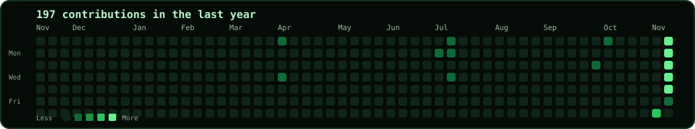
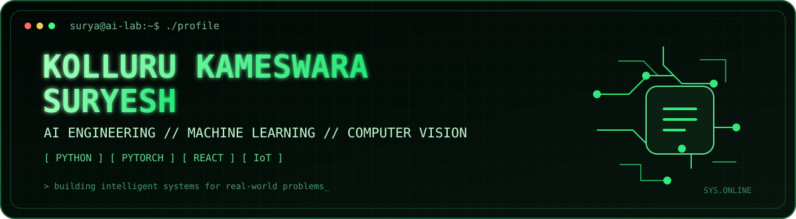
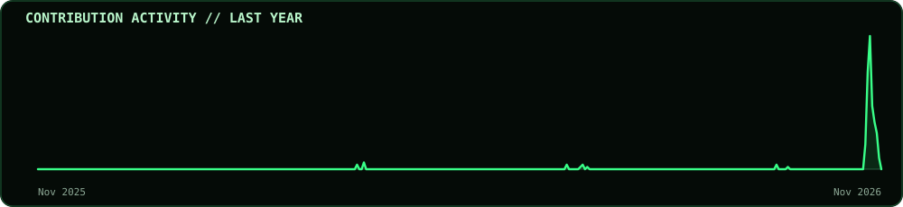
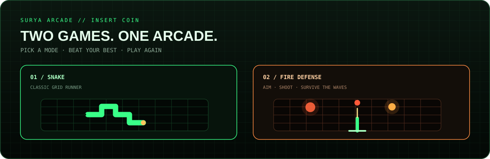

<!-- Profile README | Surya-kolluru -->

  

  
  
  

<b>Artificial Intelligence · Machine Learning · Deep Learning · Computer Vision</b>

<i>Exploring ideas. Engineering models. Building intelligent systems.</i>

---

## `> whoami`

AI Engineering student interested in machine learning, deep learning, computer vision, predictive analytics and applied AI. I enjoy building practical systems that connect intelligent models with real-world applications.

---

## `> ls /tech-stack`

**Programming**

  
  
  
  
  
  

**AI / ML and data science**

  
  
  
  
  
  
  
  
  
  
  

**Development and tools**

  
  
  
  
  
  
  
  

---

## `> ls /projects`

| Project | Tech stack |
|---|---|
| Polymer Property Prediction | Python · RDKit · LightGBM |
| Skin Cancer Classification | Deep Learning · Vision Transformers |
| Integrated Financial Risk Framework | Python · Bayesian Networks · Monte Carlo · Streamlit |
| Terrain-Aware Weather Forecasting | Python · PyTorch · LightGBM |
| Fish Behaviour and Growth Monitoring | Computer Vision · Object Tracking |
| Synapse 3D Games | Next.js · React Three Fiber · Zustand |
| Aqua-Reserve 2.0 | IoT · ESP32 · LoRaWAN |
| Plant Identification System | Python · Image Processing · Flask |

---

## `> cat /experience.log`

- **Campus Ambassador** — ShadowFox
- **Campus Ambassador** — ECell IIT Bombay
- **Campus Ambassador** — TECHBAIRN
- **Campus Ambassador** — YHILLS Educational

---

## `> echo $ACHIEVEMENTS`

  
  

- **First Prize** — Tech Savishkaar 4.0, Team Synervate.
- **Third Prize** — Amalgam 2026, IIT Madras ML Hackathon.

---

## `> education`

**B.Tech — Artificial Intelligence**  
Amrita Vishwa Vidyapeetham

---

## `> certifications`

- **Infosys Springboard** — Python, Machine Learning, Deep Learning, Computer Vision and AI.
- **UniAthena** — Python, Machine Learning, Data Science and AI.
- **Google Cloud** — Google Cloud Fundamentals.

---

## `> git stats --global`

  
  

---

## `> ./snake-animation.sh`

  

---

## `> ./arcade --play`

  

  
  &nbsp;
  

Two browser games · Keyboard and touch controls · Personal best scores saved in your browser

---

## `> ping me`

- **GitHub:** [Surya-kolluru](https://github.com/Surya-kolluru)
- **LinkedIn:** [Connect with me](https://www.linkedin.com/in/kameswara-suryesh-kolluru-35b44b33a)
- **Email:** [Contact](mailto:suryakolluru22@gmail.com)

<code>// keep learning | keep building | keep exploring</code>

